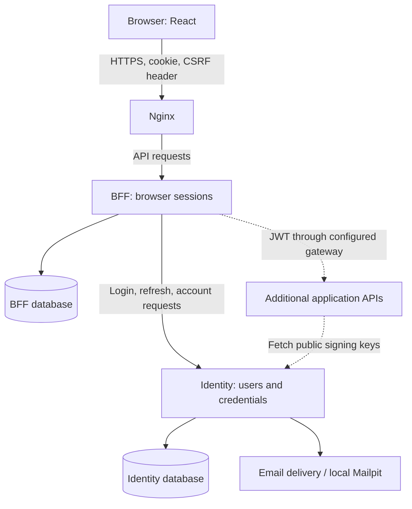

# HHLHH — Identity and browser sessions

A full-stack account system built with React, FastAPI, and PostgreSQL. It supports
password and passkey sign-in, email verification, account recovery, recent MFA
checks, and browser-session management.

I built this project to understand how authentication works across a browser,
an identity service, and application APIs. My goal was to keep user identity in
one place while allowing each application to make its own permission decisions.
The work covers the account UI, API contracts, database transactions, migrations,
and a reproducible local HTTPS deployment.

## Demo

### [▶ Watch the 5-minute HHLHH user experience walkthrough on YouTube](https://youtu.be/HpeQxEAZIc0)

[](https://youtu.be/HpeQxEAZIc0)

**What's covered:** Register and verify an email, sign in, add a secondary email through the MFA flow, enroll a passkey, sign in with it, and revoke a session.

## What the project does

| Area | Implemented behavior |
| --- | --- |
| Accounts | Registration, profile updates, primary and secondary email addresses |
| Authentication | Password login, discoverable passkey login, password recovery |
| Sensitive changes | Recent email-code or passkey verification before password, email, and passkey-enrollment changes |
| Browser sessions | Secure HttpOnly cookies, idle and absolute expiry, session history, revocation |
| Service authentication | Short-lived RS256 JWTs and a public JWKS for signature verification |
| Authorization | Identity-local roles, permissions, and audit APIs; other applications own their permission checks |
| Email | Runtime HTML templates and interchangeable SMTP/Resend delivery transports; local Mailpit inbox |
| Infrastructure | Docker Compose, Nginx HTTPS/CSP, Terraform database roles, and Alembic migrations |

The React interface covers account features. Administration is available through
Identity's API; it has no administration UI.

## How the pieces fit together



The **backend for frontend (BFF)** is the browser's API entry point. The browser
holds an opaque session cookie, while BFF keeps encrypted access and refresh
tokens server-side. BFF validates its own session and refreshes the access token
near expiry before forwarding requests.

**Identity** owns users, passwords, emails, passkeys, and authentication proofs.
Its JWT identifies the user and login session. An application verifies that JWT
using public keys, then checks its own database permissions. The gateway is an
extension point: additional application services are configured explicitly and
are not included in the current account demo.

## Problems I encountered and what I learned

| Problem | Decision and reasoning |
| --- | --- |
| A shared permission service needed assumptions about every application's tables. | Share model helpers and JWT verification, but keep permission queries inside the application that owns the data. This makes the boundary between authentication and authorization explicit. |
| The browser needed authentication without handling JWTs directly. | Add a BFF with database-backed cookie sessions. This introduces session storage and cleanup work, but keeps access/refresh tokens out of frontend code. |
| Cookies are sent automatically, so writes needed CSRF protection. | Require an exact matching Origin and a CSRF header. Before login, derive the token from an anonymous HttpOnly cookie; after login, derive it from the session secret. React keeps only the returned token in memory. |
| Concurrent requests could try to rotate the same refresh token. | Serialize refresh with a PostgreSQL row lock. If a rotated response is lost, fail closed rather than retrying an old refresh token. SQLite alone cannot prove this behavior. |
| A password login was insufficient proof for a later sensitive change. | Require a recent challenge tied to the current Identity session. The UI pauses the requested change, verifies a code or passkey, then resumes it once; the backend checks the proof again. |
| Postman worked while browser registration failed. | Trace the actual request origin. A Vite server without an API proxy served HTML for API paths; later, `https://127.0.0.1` did not match the configured `https://localhost` origin. The fix was a consistent HTTPS entry point. |
| The application and migration tool needed different database privileges. | Give each service its own database, a non-login owner, an app login for data operations, and a migrator that explicitly assumes the owner role. Terraform provisions access; Alembic versions table changes. |
| Passkeys needed more than a new login button. | Bind short-lived, single-use challenges to the requesting browser and verify the WebAuthn signature, origin, RP ID, user handle, and authenticator flags. Consume the challenge and create the session in one transaction. |

These choices are tradeoffs I explored in the project. They are not a claim of an
independent security audit or a large-scale production deployment.

## Repository map

```text
apps/
  web/                       React account SPA
  server/                    uv workspace
    identity/                account authority and JWT issuer
    bff/                     browser sessions and API gateway
    migrations/              separate Identity and BFF Alembic histories
    lib/auth-token/          shared JWT/JWKS verification
    lib/authz-helper/        shared authorization model mixins
    lib/email-delivery/      SMTP and Resend transports
infra/
  docker/                    Compose configuration and setup guide
  nginx/                     SPA build, TLS proxy, and security headers
  terraform/                 PostgreSQL databases, roles, and grants
```

## Run locally

All documented commands run from the repository root. Use Bash, Docker Compose
with support for `!override`, uv, Python 3.12+, Terraform 1.11+, and OpenSSL.
The frontend build uses Node 24, including inside Docker.

Follow the [local deployment guide](infra/docker/README.md) to configure secrets
and TLS, then run PostgreSQL, provision databases, and apply both migration
histories before starting the applications. Containers do not run migrations
automatically.

Once configured, open **https://localhost** and the local email inbox at
**http://localhost:8025**. Use the same hostname as `BFF_PUBLIC_ORIGIN` and
`WEBAUTHN_ORIGIN`; trust the local certificate before testing passkeys.

## Validation and current limits

The [server guide](apps/server/README.md#checks) lists the unit and API test
commands. Tests cover token validation, CSRF, session lifecycle, refresh replay,
challenge expiry, passkey assertions, and permission enforcement. Optional
disposable PostgreSQL databases enable the row-lock concurrency tests. Frontend
checks cover TypeScript/build, linting, and authentication helpers.

The gateway currently handles bounded JSON requests and responses. Uploads,
streaming, WebSockets, and a passkey management list/delete API are not implemented.
Rate limits are per process, and verification/reset email tasks have no durable
queue. A service verifying JWTs offline observes revocation when the token expires;
immediate downstream revocation needs an additional session check. The Terraform
provider currently uses a local PostgreSQL connection with TLS disabled.

## Component documentation

- [Server workspace and test commands](apps/server/README.md)
- [Identity API, challenges, and permissions](apps/server/identity/README.md)
- [BFF cookies, CSRF, refresh, and gateway](apps/server/bff/README.md)
- [React pages and account flows](apps/web/README.md)
- [Database migrations](apps/server/migrations/README.md)
- [Docker, TLS, and database setup](infra/docker/README.md)
- [JWT verification](apps/server/lib/auth-token/README.md), [authorization helpers](apps/server/lib/authz-helper/README.md), and [email transports](apps/server/lib/email-delivery/README.md)
